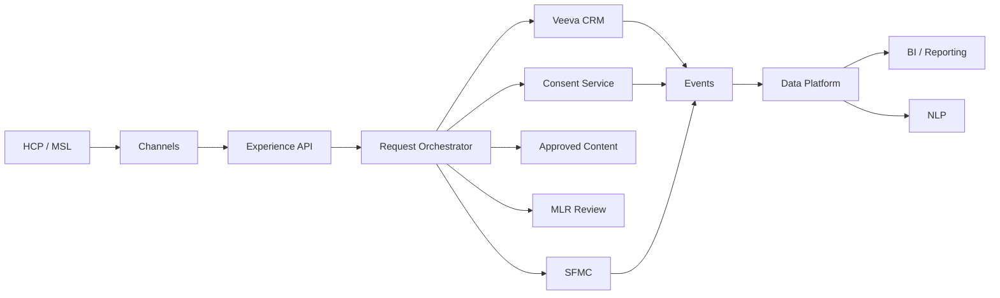
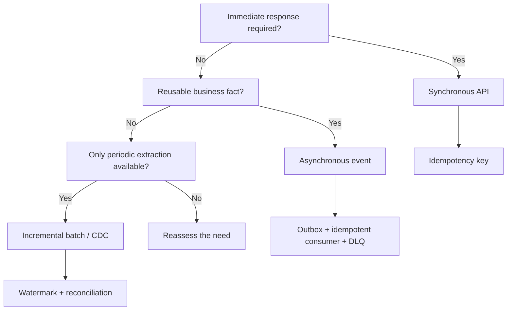
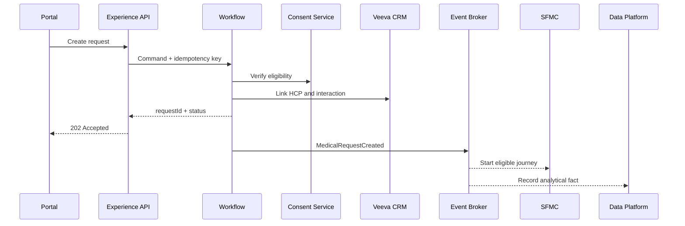
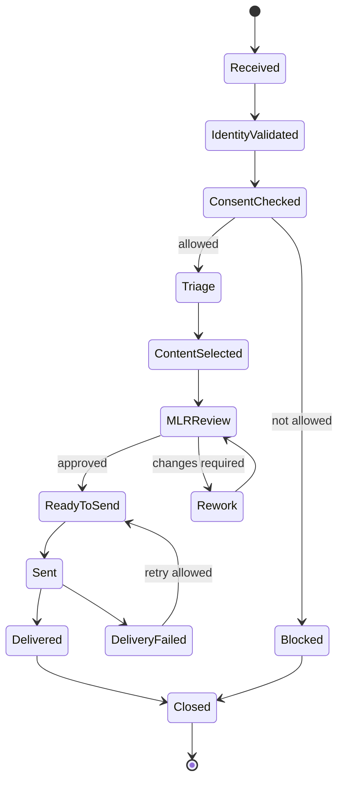
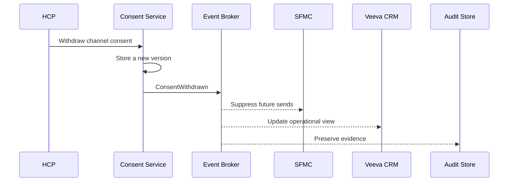
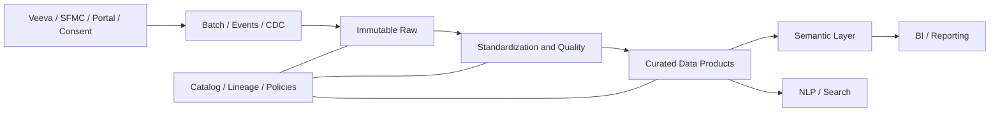
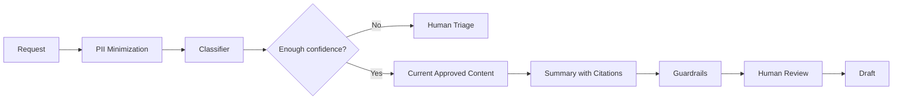
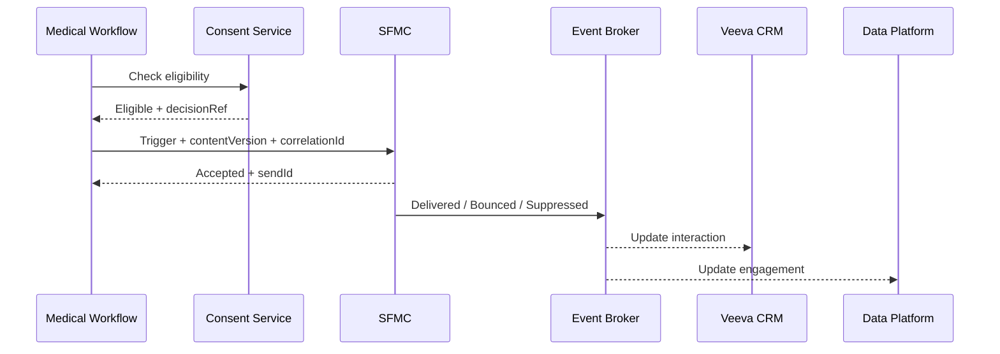

# Architectures and Distributed Systems

[Versión en español](README.md)

Practical, **cloud-agnostic** examples for a **Medical Affairs Architect** position.

The deployment platform comes last. The reasoning starts with:

> Business problem → capability → ownership → boundaries → data → integration → consistency → NFRs → failure modes → security/compliance → migration → technology.

## Cross-cutting scenario

An HCP requests scientific information. A Medical Science Liaison (MSL) records the interaction; the response goes through medical, legal, and regulatory review; the HCP receives approved content through an allowed channel; and the outcomes feed analytics and NLP. The landscape includes Veeva CRM, Salesforce Marketing Cloud (SFMC), a consent service, a content repository, an integration layer, a data platform, and BI.

Products represent functional boundaries, not infrastructure choices. Exact capabilities must be validated against the edition, configuration, and contract of each tenant.

## 1. Solution blueprint

**Objective:** respond to scientific information requests in a traceable, resilient, and compliant manner.

Logical flow:

Decisions:

- Veeva is the system of record for field interactions.
- Consent Service is authoritative for purpose, channel, region, and validity.
- The regulated repository is the source of approved content.
- The orchestrator owns case state without duplicating all neighboring business logic.
- APIs handle commands or queries that need an immediate response; events distribute facts.
- The data platform is analytical and never authorizes a real-time communication.

Example NFRs:

| Attribute | Objective |
|---|---|
| Availability | 99.9% monthly for request registration |
| Experience | Confirmation in under 3 seconds |
| Auditability | Actor, purpose, consent decision, version, and timestamps |
| Recovery | RPO ≤ 15 min; RTO ≤ 2 h |
| Resilience | Idempotency, bounded retries, DLQ, and reconciliation |
| Privacy | Minimization, encryption, segregation, and retention |

A complete blueprint includes context, boundaries, ownership, trust boundaries, critical flows, NFRs, risks, assumptions, and open decisions.

## 2. Architecture decision tree

**Question:** how should a medical information request be integrated?

1. Does the consumer need an immediate response?
   - Yes: synchronous API.
   - No: continue.
2. Is this a reusable business fact?
   - Yes: asynchronous event.
   - No: continue.
3. Does the source only support periodic extraction?
   - Yes: incremental batch or CDC.
   - No: question whether the integration is necessary.
4. Can the operation be repeated after a timeout?
   - Yes: use an idempotency key.
   - No: avoid automatic retries or design a compensation.
5. For events: outbox, idempotent consumer, versioning, and DLQ.
6. For batch: watermark, duplicate control, and reconciliation.

Application:

- Create the case and return requestId: API.
- Announce MedicalRequestCreated: event.
- Check consent: query the authoritative operational system.
- Load legacy history: incremental batch.
- Update reporting: event or micro-batch with eventual consistency.

The choice depends on semantics, latency, ownership, volume, temporal coupling, and behavior under failure.

## 3. Architecture reviews and approvals

**Proposal under review:** SFMC reads operational consent tables directly.

Checklist:

| Area | Question |
|---|---|
| Business | Which capability and outcome does this enable? |
| Ownership | Who makes the consent decision? |
| Integration | Is there a versioned contract or direct table coupling? |
| Data | Are fields and retention minimized? |
| Security | Are SSO, RBAC, encryption, and segregation defined? |
| Compliance | Are purpose, version, and evidence retained? |
| Resilience | What happens when a dependency fails? |
| Operations | Are SLOs, metrics, alerts, and a runbook defined? |
| Change | How is it tested, versioned, and rolled back? |
| Portability | Is critical logic locked into the product? |

**Decision:** conditional approval. Replace direct table access with a versioned contract; expose only the minimum data; retain a decisionRef; fail closed when permission cannot be verified; add reconciliation and negative tests; document the decision in an ADR.

Approval flow: proposer → domain review → security/privacy → data governance → architecture → Medical/Legal/Regulatory when applicable → verified closure of conditions.

An approval needs an owner, scope, conditions, evidence, and expiration date.

## 4. Integration across multiple systems and technology stacks

Sequence:

1. The portal sends POST /medical-information-requests with an idempotency key.
2. Experience API asks the workflow to create the case.
3. The workflow verifies consent and links the HCP/interaction in Veeva.
4. It returns 202 Accepted with requestId; it does not wait for all downstream processing.
5. It publishes MedicalRequestCreated.
6. SFMC consumes the event only when the request is eligible.
7. The data platform records the analytical fact.

Minimum canonical contract: eventId, eventType, schemaVersion, occurredAt, correlationId, requestId, pseudonymized HCP reference, country, purpose, and source system.

Distributed-systems controls:

- Transactional outbox to prevent “data saved, event lost.”
- Deduplication by eventId.
- Retries with backoff and jitter only for transient failures.
- DLQ with an owner and replay procedure.
- End-to-end correlation ID.
- Compatible schema evolution.
- Ordering only where semantics require it, for example per requestId.
- Reconciliation across cases, sends, and interactions.
- Do not assume exactly-once delivery; design idempotent consumers.

## 5. End-to-end workflow

States:

Branches: ConsentChecked may move to Blocked; MLRReview may move to Rework; Sent may move to DeliveryFailed; an allowed retry returns the case to ReadyToSend.

Rules:

- Every transition records its precondition, actor, timestamp, and reason.
- Content is pinned to a version; later approval does not rewrite history.
- Sent does not mean Delivered.
- A timeout creates an operational task; it does not force the next state.
- Side effects use saga-style coordination and business compensations.
- If SFMC accepted a send but CRM recording failed, preserve sendId and reconcile; do not attempt to “unsend” the message.
- If Consent Service is unavailable, keep the case pending and do not send. Re-evaluate validity after recovery.

## 6. Multi-channel orchestration

**Example policy:**

If the purpose is medical-information, email consent is valid, the frequency limit has not been exceeded, and content is approved for the country/language, send email. If email is not allowed but the portal is, publish there and notify only through an allowed channel. If the request needs scientific dialogue, create an MSL task; do not automatically replace it with marketing.

Capabilities:

- Decisioning: eligibility, priority, frequency, and next best channel.
- Orchestration: sequence, waits, suppression, and timeouts.
- Execution: SFMC or another channel engine executes.
- Feedback: delivery, bounce, webinar attendance, and response.
- Veeva: the operational view relevant to the MSL.
- Analytics: outcomes under common semantics.

A shared interactionId and a central policy prevent two journeys from deciding independently. Revocation and suppression always take priority over campaign activity.

## 7. Consent management

Conceptual model:

| Field | Example |
|---|---|
| Subject | HCP-9f2a |
| Purpose | medical-information |
| Channel | email |
| Status | granted / denied / withdrawn |
| Jurisdiction | MX |
| Source | portal |
| Effective / expiry | time interval |
| Policy version | v3 |
| Evidence reference | signed record |

Revocation:

Decisions:

- Version consent; never overwrite its history.
- Evaluate purpose + channel + region + validity, not one universal boolean.
- Give revocation events priority processing and a measurable SLA.
- Veeva and SFMC may hold operational projections, not alternative masters.
- The analytical platform never authorizes communications.
- When records disagree, apply the most restrictive option and reconcile.
- Test the negative right: an HCP without permission must not enter an audience.

## 8. Data platform

Layers:

Catalog, lineage, policies, and quality apply across all layers.

HCP Engagement 360 data product:

- business owner and data steward;
- data contract and agreed definitions;
- HCP identity resolved with explainable rules;
- event, ingestion, and processing timestamps;
- quality indicators and lineage;
- classification, access, and retention;
- freshness SLO.

Consistency choices:

- Consent used to send: authoritative operational source.
- Daily dashboard: eventual consistency is acceptable.
- MSL interactions: incremental ingestion with reconciliation.
- Regulated counts: reproducible snapshot and rule version.

Technology can change without changing the contracts, ownership, and controls.

## 9. Reporting

Medical Information Operations dashboard:

| KPI | Definition |
|---|---|
| Requests received | Unique cases created |
| First response time | Case creation to first human or approved response |
| Resolution time | Case creation to Closed |
| SLA compliance | Cases completed within the applicable SLA |
| Consent-blocked rate | Cases without an allowed channel / cases ready to answer |
| Delivery success | Confirmed deliveries / valid attempts |
| Rework rate | Cases returned / cases reviewed |
| Top scientific topics | NLP topics above the confidence threshold |

Controls: metrics are defined in the semantic layer; slowly changing dimensions preserve organizational history; row-level security limits access; drill-through respects authorization; data freshness is visible; results reconcile to source systems; exports are audited.

Every KPI requires a formula, grain, time zone, owner, exclusions, expected latency, and tests. “Number of interactions” is not a valid metric until the organization agrees on what counts as an interaction.

## 10. NLP

Use case: classify requests by scientific topic and operational urgency, suggest approved content, and improve search. The model does not diagnose or prescribe.

Flow:

Low-confidence requests go to human triage.

Controls:

- Taxonomy agreed with Medical Affairs.
- Representative, versioned data with known provenance.
- Train/validation/test separation without leakage.
- Metrics by language, country, and category.
- Abstention threshold and human-in-the-loop.
- Citations to source, version, and effective date.
- Defense against prompt injection in retrieved documents.
- Factuality, groundedness, privacy, and drift evaluation.
- Model card, data card, and decision log.

Safe failure: if no approved source exists, return “requires review”; never invent a recommendation.

## 11. Veeva CRM

After a meeting, the MSL records HCP/HCO, date, channel, scientific topics, shared materials, follow-up, and a reference to the medical request when applicable.

Integration:

1. Veeva retains the field interaction.
2. A confirmed change exposes InteractionRecorded.
3. The integration layer transforms it to the enterprise contract.
4. The data platform updates analytics.
5. A follow-up creates an idempotent task in the workflow.
6. Free-text notes never modify consent automatically.

Review API capabilities and quotas; tenant-specific objects; HCP duplicates; field-level access; sensitive free text; allowed synchronization latency; bulk loads and backfills; internal/external ID mapping; sandboxes; contract tests; and rollback.

Veeva must not become the integration bus or the master of every domain.

## 12. Salesforce Marketing Cloud (SFMC)

Example: send a scientific response or invitation only when purpose, consent, frequency, and content are valid, with a correlationId linked to the original case.

Flow:

1. The workflow requests eligibility from Consent Service.
2. It receives Eligible + decisionRef.
3. It triggers SFMC with contentVersion and correlationId.
4. SFMC returns Accepted + sendId.
5. Delivered, Bounced, or Suppressed events update Veeva and the data platform.

Controls:

- Copy only necessary HCP attributes.
- Avoid scattering critical logic across many journeys.
- Use stable business keys and explicit mappings.
- Separate accepted for send from delivered.
- Treat bounce and suppression as domain facts.
- Version templates and content.
- Test duplicates, delays, out-of-order events, and revocation during a journey.
- Reconcile sendId, correlationId, and requestId.

SFMC executes communications; it is not the master of identity, consent, or scientific content.

## 13. SaaS architecture review

Scenario: evaluate an NLP SaaS that processes HCP requests and suggests topics.

| Dimension | Expected evidence |
|---|---|
| Functional | Languages, taxonomy, human-in-the-loop, and representative tests |
| Architecture | APIs/events, versioning, quotas, and bulk support |
| Security | SSO, MFA, RBAC, encryption, and tenant isolation |
| Privacy | Residency, subprocessors, retention, and deletion |
| Compliance | Audit trail and exportable evidence |
| AI | Provenance, evaluation, and training opt-out |
| Resilience | SLA, RTO/RPO, and tested DR |
| Operations | Logs, alerts, support, and joint runbook |
| Portability | Complete export and open formats |
| Commercial | Volume pricing, overages, and egress |
| Continuity | Termination and change-of-control clauses |

**Decision:** conditional pilot approval, not production approval. Process only de-identified text; prohibit training on customer data; require human review; test deletion, export, and tenant isolation; meet minimum metrics per language; document the manual fallback; complete a threat model and DPIA where applicable.

Exit plan: export configurations and logs; keep internal contracts vendor-neutral; wrap the vendor SDK behind an interface; retain owned evaluation datasets; estimate migration time and cost; test the exit before it is needed.

## Example ADR: authoritative consent source

**Status:** Accepted.

**Context:** Veeva, SFMC, and the portal need a consent view, but three masters create divergence and regulatory risk.

**Decision:** Consent Service will be authoritative; other systems will maintain projections. Revocations will propagate through a priority event. A communication will use a current decision or a projection with an explicit TTL and policy.

**Alternatives considered:**

- Veeva as master: strong for field activity, but insufficient for all channels and purposes.
- SFMC as master: optimized for execution, but couples enterprise policy to the campaign engine.
- Data platform as master: does not meet operational latency or semantics.

**Consequences:**

- High availability and reconciliation are required.
- Consumers must tolerate duplicates and out-of-order delivery.
- Fail-closed may delay communications, which is preferable to an unauthorized send.

## How to use this guide in an interview

1. Clarify the capability and business outcome.
2. Draw actors, system boundaries, and trust boundaries.
3. Assign a system of record to each domain.
4. Separate commands, queries, and events.
5. Explain consistency, idempotency, and ordering.
6. Define measurable NFRs.
7. Walk through partial failures and recovery.
8. Add consent, security, auditability, and retention.
9. Propose operations, migration, and an exit plan.
10. Only then map the design to available products and infrastructure.

The deployment platform intentionally comes last. Architecture quality depends first on boundaries, contracts, ownership, semantics, and failure behavior.
