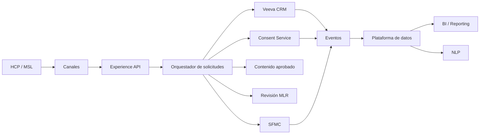
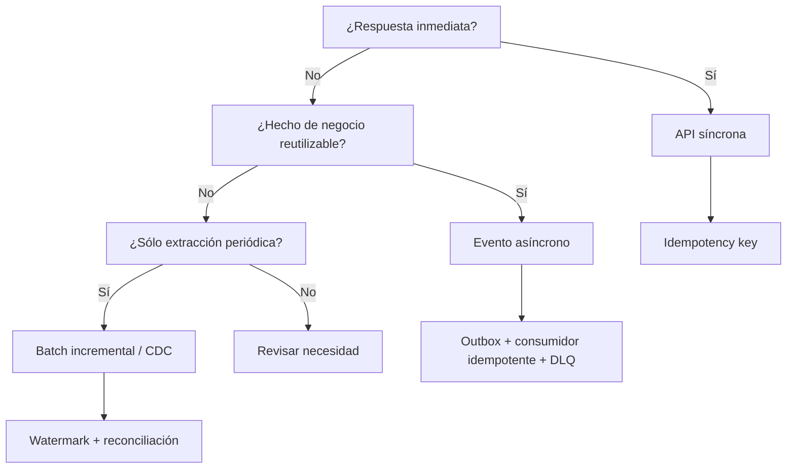
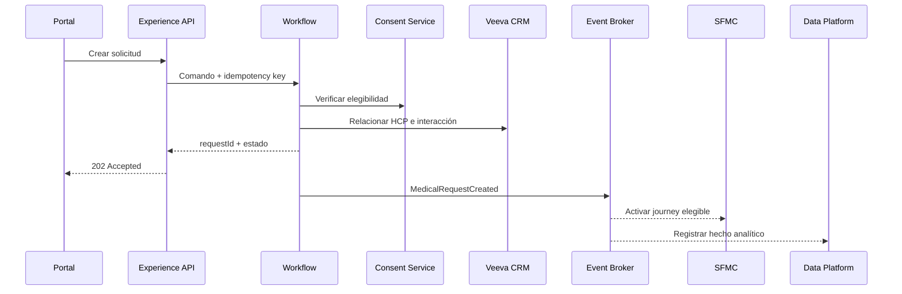
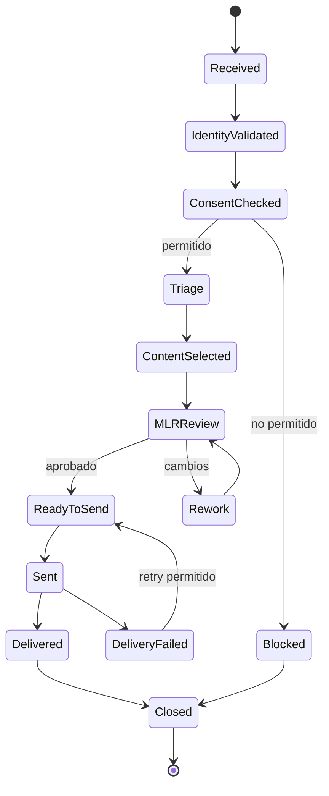
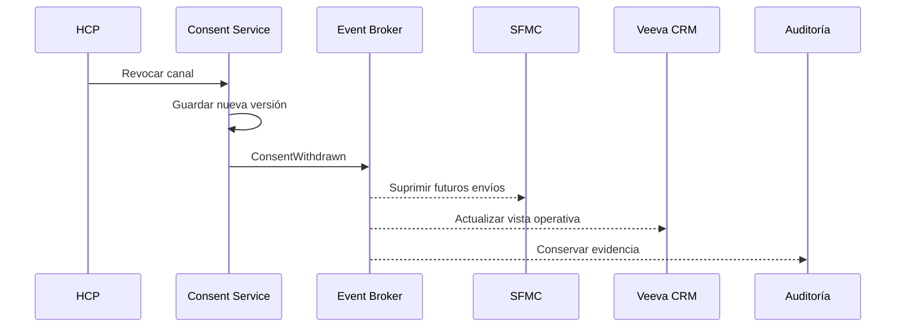
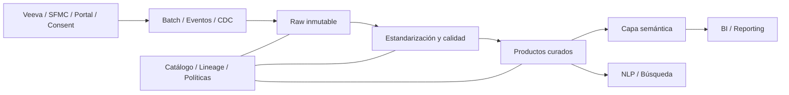
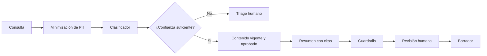
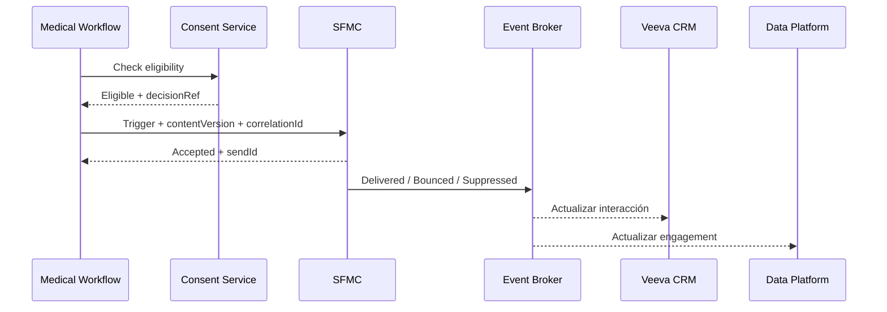

# Architectures and Distributed Systems

Ejemplos prácticos y **cloud-agnostic** para una posición de **Medical Affairs Architect**.

La plataforma de despliegue queda al final. El razonamiento comienza así:

> Problema de negocio → capability → ownership → límites → datos → integración → consistencia → NFRs → fallos → seguridad/compliance → migración → tecnología.

## Caso transversal

Un HCP solicita información científica. Un Medical Science Liaison (MSL) registra la interacción; la respuesta pasa por revisión médico-legal-regulatoria; el HCP recibe contenido aprobado por un canal permitido; los resultados alimentan analítica y NLP. Participan Veeva CRM, Salesforce Marketing Cloud (SFMC), un servicio de consentimiento, un repositorio de contenido, una capa de integración, una plataforma de datos y BI.

Los productos representan límites funcionales, no infraestructura. Las capacidades exactas deben validarse contra la edición, configuración y contrato de cada tenant.

## 1. Solution blueprint

**Objetivo:** responder solicitudes científicas de forma trazable, resiliente y conforme.

Flujo lógico:

Decisiones:

- Veeva es system of record de interacciones de campo.
- Consent Service es la autoridad para propósito, canal, región y vigencia.
- El repositorio regulado es la fuente de contenido aprobado.
- El orquestador conserva el estado del caso, sin replicar toda la lógica de sus vecinos.
- Las APIs atienden comandos o consultas inmediatas; los eventos distribuyen hechos.
- La plataforma de datos es analítica y nunca autoriza un envío en tiempo real.

NFRs de ejemplo:

| Atributo | Objetivo |
|---|---|
| Disponibilidad | 99.9% mensual para registrar solicitudes |
| Experiencia | Confirmación en menos de 3 segundos |
| Auditoría | Actor, propósito, decisión de consentimiento, versión y timestamps |
| Recuperación | RPO ≤ 15 min; RTO ≤ 2 h |
| Resiliencia | Idempotencia, retries acotados, DLQ y reconciliación |
| Privacidad | Minimización, cifrado, segregación y retención |

Un blueprint completo incluye contexto, límites, ownership, trust boundaries, flujos críticos, NFRs, riesgos, supuestos y decisiones abiertas.

## 2. Architecture decision tree

**Pregunta:** ¿cómo integrar una solicitud médica?

1. ¿El consumidor necesita respuesta inmediata?
   - Sí: API síncrona.
   - No: continuar.
2. ¿Se comunica un hecho de negocio reutilizable?
   - Sí: evento asíncrono.
   - No: continuar.
3. ¿El origen sólo permite extracción periódica?
   - Sí: batch incremental o CDC.
   - No: cuestionar si la integración es necesaria.
4. ¿La operación puede repetirse tras un timeout?
   - Sí: idempotency key.
   - No: evitar retry automático o diseñar compensación.
5. Para eventos: outbox, consumidor idempotente, versionado y DLQ.
6. Para batch: watermark, control de duplicados y reconciliación.

Aplicación:

- Crear el caso y devolver requestId: API.
- Notificar MedicalRequestCreated: evento.
- Comprobar consentimiento: consulta al sistema autoritativo.
- Cargar histórico legado: batch incremental.
- Actualizar reporting: evento o micro-batch, con consistencia eventual.

La elección depende de semántica, latencia, ownership, volumen, acoplamiento temporal y comportamiento ante fallos.

## 3. Architecture reviews y approvals

**Propuesta a revisar:** SFMC consulta directamente tablas operacionales de consentimiento.

Checklist:

| Área | Pregunta |
|---|---|
| Negocio | ¿Qué capability y resultado habilita? |
| Ownership | ¿Quién decide el consentimiento? |
| Integración | ¿Hay contrato versionado o acoplamiento a tablas? |
| Datos | ¿Se minimizan campos y retención? |
| Seguridad | ¿SSO, RBAC, cifrado y segregación? |
| Compliance | ¿Se conserva propósito, versión y evidencia? |
| Resiliencia | ¿Qué ocurre si una dependencia falla? |
| Operación | ¿Hay SLOs, métricas, alertas y runbook? |
| Cambio | ¿Cómo se prueba, versiona y revierte? |
| Portabilidad | ¿La lógica queda atrapada en el producto? |

**Decisión:** aprobación condicionada. Sustituir tablas por un contrato versionado; exponer sólo el mínimo de datos; registrar decisionRef; aplicar fail-closed cuando no pueda comprobarse el permiso; añadir reconciliación y pruebas negativas; documentar un ADR.

Flujo: proponente → dominio → seguridad/privacidad → data governance → arquitectura → Medical/Legal/Regulatory cuando corresponda → cierre verificable de condiciones.

Una aprobación debe tener owner, alcance, condiciones, evidencia y fecha de expiración.

## 4. Integración de múltiples sistemas y tech stacks

Secuencia:

1. Portal envía POST /medical-information-requests con idempotency key.
2. Experience API solicita al workflow crear el caso.
3. Workflow verifica consentimiento y relaciona el HCP/interacción en Veeva.
4. Devuelve 202 Accepted con requestId; no espera todo el procesamiento.
5. Publica MedicalRequestCreated.
6. SFMC consume el evento sólo si es elegible.
7. La plataforma de datos registra el hecho analítico.

Contrato canónico mínimo: eventId, eventType, schemaVersion, occurredAt, correlationId, requestId, HCP pseudonimizado, país, propósito y sistema de origen.

Controles distribuidos:

- Transactional outbox para evitar “dato guardado, evento perdido”.
- Deduplicación por eventId.
- Retries con backoff y jitter sólo para errores transitorios.
- DLQ con owner y procedimiento de replay.
- Correlation ID end-to-end.
- Compatibilidad de schemas.
- Orden sólo donde la semántica lo exige, por ejemplo por requestId.
- Reconciliación entre casos, envíos e interacciones.
- No asumir exactly-once: diseñar consumidores idempotentes.

## 5. Workflow end-to-end

Estados:

Ramas: ConsentChecked puede pasar a Blocked; MLRReview a Rework; Sent a DeliveryFailed; un retry permitido vuelve a ReadyToSend.

Reglas:

- Cada transición registra precondición, actor, timestamp y motivo.
- El contenido se fija por versión; una nueva aprobación no reescribe el pasado.
- Sent no significa Delivered.
- Un timeout crea una tarea operativa; no fuerza el siguiente estado.
- Los side effects usan saga y compensación empresarial.
- Si SFMC aceptó el envío pero falló el registro en CRM, se conserva sendId y se reconcilia; no se intenta “desenviar”.
- Si Consent Service está caído, el caso queda pendiente y no se envía. Al recuperarse, se reevalúa la vigencia.

## 6. Multi-channel orchestration

**Política de ejemplo:**

Si el propósito es medical-information, consentimiento(email) es válido, la frecuencia no excede el límite y el contenido está aprobado para país/idioma, enviar email. Si no hay email pero sí portal, publicar allí y notificar únicamente por un canal permitido. Si la consulta requiere diálogo científico, crear tarea para MSL; no sustituirla automáticamente por marketing.

Capacidades:

- Decisioning: elegibilidad, prioridad, frecuencia y next best channel.
- Orchestration: secuencia, esperas, supresión y timeouts.
- Execution: SFMC u otro motor ejecuta.
- Feedback: delivery, bounce, webinar y respuesta.
- Veeva: vista operativa relevante para el MSL.
- Analytics: resultados con semántica común.

Un interactionId y una política central evitan que dos journeys decidan aisladamente. Revocación y supresión tienen prioridad sobre campañas.

## 7. Consent management

Modelo:

| Campo | Ejemplo |
|---|---|
| Subject | HCP-9f2a |
| Purpose | medical-information |
| Channel | email |
| Status | granted / denied / withdrawn |
| Jurisdiction | MX |
| Source | portal |
| Effective / expiry | intervalo |
| Policy version | v3 |
| Evidence reference | registro firmado |

Revocación:

Decisiones:

- Consentimiento versionado; nunca sobrescribir historia.
- Evaluar propósito + canal + región + vigencia, no un booleano universal.
- Dar prioridad y SLA a revocaciones.
- Veeva y SFMC pueden tener proyecciones, no masters alternos.
- La plataforma analítica nunca autoriza.
- Ante discrepancia, aplicar la opción más restrictiva y reconciliar.
- Probar el derecho negativo: un HCP sin permiso no entra en audiencia.

## 8. Data platform

Capas:

Catálogo, lineage, políticas y calidad atraviesan todas las capas.

Producto HCP Engagement 360:

- owner de negocio y data steward;
- contrato y definiciones;
- identidad HCP con reglas explicables;
- tiempos de evento, ingesta y procesamiento;
- calidad y lineage;
- clasificación, acceso y retención;
- SLO de frescura.

Consistencia:

- Consentimiento para enviar: fuente operacional.
- Dashboard diario: consistencia eventual.
- Interacciones MSL: incremental con reconciliación.
- Conteos regulados: snapshot reproducible y versión de reglas.

La tecnología puede cambiar sin alterar contratos, ownership y controles.

## 9. Reporting

Dashboard Medical Information Operations:

| KPI | Definición |
|---|---|
| Requests received | Casos únicos creados |
| First response time | Inicio a primera respuesta humana o aprobada |
| Resolution time | Inicio a Closed |
| SLA compliance | Casos dentro de su SLA |
| Consent-blocked rate | Casos sin canal permitido / listos para responder |
| Delivery success | Entregas confirmadas / intentos válidos |
| Rework rate | Casos devueltos / revisados |
| Top scientific topics | Temas NLP sobre el umbral de confianza |

Controles: métricas en capa semántica; dimensiones lentamente cambiantes; row-level security; drill-through autorizado; frescura visible; reconciliación al origen; exportaciones auditadas.

Cada KPI necesita fórmula, granularidad, zona horaria, owner, exclusiones, latencia y pruebas. “Número de interacciones” no es válido hasta definir qué cuenta como interacción.

## 10. NLP

Caso: clasificar consultas por tema y urgencia operativa, sugerir contenido aprobado y mejorar búsqueda. El modelo no diagnostica ni prescribe.

Flujo:

Si la confianza es baja, pasa a triage humano.

Controles:

- Taxonomía acordada con Medical Affairs.
- Datos representativos, versionados y con procedencia.
- Separación train/validation/test sin leakage.
- Métricas por idioma, país y categoría.
- Abstención y human-in-the-loop.
- Citas a fuente, versión y vigencia.
- Defensa contra prompt injection documental.
- Evaluación de factualidad, groundedness, privacidad y drift.
- Model card, data card y registro de decisiones.

Fallo seguro: si no hay fuente aprobada, “requiere revisión”; nunca inventar una recomendación.

## 11. Veeva CRM

Después de una reunión, el MSL registra HCP/HCO, fecha, canal, temas científicos, materiales, follow-up y referencia a la solicitud.

Integración:

1. Veeva conserva la interacción de campo.
2. Un cambio confirmado expone InteractionRecorded.
3. La capa de integración transforma al contrato empresarial.
4. Datos actualiza analítica.
5. Un follow-up crea una tarea idempotente en el workflow.
6. Notas libres nunca cambian consentimiento automáticamente.

Revisar cuotas y APIs; objetos configurados; duplicados HCP; acceso a campos; texto sensible; latencia; bulk/backfill; mapeo de IDs; sandbox; pruebas de contrato y rollback.

Veeva no debe convertirse en bus de integración ni master de todos los dominios.

## 12. Salesforce Marketing Cloud (SFMC)

Ejemplo: enviar respuesta o invitación sólo si propósito, consentimiento, frecuencia y contenido son válidos, con correlationId al caso original.

Flujo:

1. Workflow solicita eligibility al Consent Service.
2. Recibe Eligible + decisionRef.
3. Dispara SFMC con contentVersion y correlationId.
4. SFMC devuelve Accepted + sendId.
5. Eventos Delivered, Bounced o Suppressed actualizan Veeva y datos.

Controles:

- Copiar sólo atributos necesarios.
- Evitar lógica crítica dispersa en journeys.
- Usar claves estables y mapeos explícitos.
- Separar aceptado de entregado.
- Tratar bounce y suppression como hechos.
- Versionar templates.
- Probar duplicados, retrasos, eventos fuera de orden y revocación durante el journey.
- Reconciliar sendId, correlationId y requestId.

SFMC ejecuta comunicaciones; no es master de identidad, consentimiento o contenido científico.

## 13. SaaS architecture review

Escenario: evaluar un SaaS NLP para consultas de HCP.

| Dimensión | Evidencia |
|---|---|
| Funcional | Idiomas, taxonomía, human-in-the-loop y pruebas |
| Arquitectura | APIs/eventos, versionado, cuotas y bulk |
| Seguridad | SSO, MFA, RBAC, cifrado e aislamiento |
| Privacidad | Residencia, subprocesadores, retención y borrado |
| Compliance | Auditoría y evidencia exportable |
| IA | Procedencia, evaluación, opt-out de entrenamiento |
| Resiliencia | SLA, RTO/RPO y DR probado |
| Operación | Logs, alertas, soporte y runbook |
| Portabilidad | Exportación y formatos abiertos |
| Comercial | Volumen, overages y egress |
| Continuidad | Terminación y cambio de control |

**Decisión:** piloto condicionado, no producción. Procesar texto desidentificado; prohibir entrenamiento con datos del cliente; revisión humana obligatoria; probar borrado/exportación/aislamiento; métricas mínimas por idioma; fallback manual; threat model y DPIA cuando aplique.

Exit plan: exportar configuración y logs; contratos internos independientes; encapsular SDK; conservar datasets de evaluación; estimar migración; probar la salida antes de necesitarla.

## ADR de ejemplo: fuente autoritativa de consentimiento

**Estado:** Accepted.

**Contexto:** Veeva, SFMC y portal necesitan consentimiento, pero tres masters crean divergencia y riesgo.

**Decisión:** Consent Service será autoritativo; los demás mantendrán proyecciones. Revocaciones viajarán por evento prioritario. Una comunicación usará una decisión vigente o una proyección con TTL y política explícita.

**Alternativas:** Veeva es fuerte en campo pero no cubre todos los canales; SFMC acopla política al motor de campañas; datos no cumple semántica ni latencia operacional.

**Consecuencias:** alta disponibilidad y reconciliación; tolerancia a duplicados y orden distinto; fail-closed puede retrasar mensajes, preferible a un envío no autorizado.

## Cómo usarlo en entrevista

1. Aclarar capability y resultado.
2. Dibujar actores, límites y trust boundaries.
3. Asignar system of record por dominio.
4. Separar comandos, consultas y eventos.
5. Explicar consistencia, idempotencia y orden.
6. Definir NFRs medibles.
7. Recorrer fallos parciales.
8. Añadir consentimiento, seguridad, auditoría y retención.
9. Proponer operación, migración y exit plan.
10. Sólo entonces mapear productos e infraestructura.
