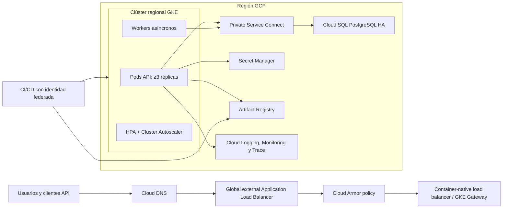

# Runbook: SaaS B2B regionalmente resiliente en Google Cloud

**Arquitectura:** API multi-tenant para SaaS B2B con picos previsibles de tráfico.  
**Cloud seleccionada:** Google Cloud.  
**Propietario:** kill -9.  
**Estado:** patrón de referencia; requiere validación de seguridad, capacidad y costes por cliente.

## 1. Resumen y alcance

Este diseño sirve una API web multi-tenant en una región de Google Cloud, tolerando la caída de una zona y reduciendo el radio de impacto de despliegues. El plano de cómputo es un clúster regional de GKE; la persistencia transaccional vive en Cloud SQL for PostgreSQL configurado para alta disponibilidad; y el borde usa un balanceador HTTP(S) global con Cloud Armor.

No promete continuidad ante la pérdida total de la región. Para ese requisito se debe diseñar una segunda región, replicación de datos y un procedimiento explícito de failover; no se asume que “multirregión” sea gratis ni automático.

### Perfil de cliente

- SaaS B2B con tráfico HTTP/HTTPS, usuarios autenticados y una base de datos relacional.
- Objetivo inicial de disponibilidad de la API: **99.9% mensual**.
- RPO objetivo: **≤15 minutos** mediante backups/PITR validados; RTO objetivo por incidente zonal: **≤60 minutos**. Ajustar estos objetivos antes de contratar compromisos de negocio.

### Restricciones y no objetivos

- Una sola región; la latencia debe concentrarse cerca de la región elegida.
- No se almacenan secretos en imágenes, repositorios ni manifiestos Kubernetes.
- No se incluyen data warehouse, colas de larga retención ni recuperación regional automática.

## 2. Diagrama

## 3. Componentes y responsabilidades

| Componente | Responsabilidad | Límite operativo |
|---|---|---|
| Load Balancer + Cloud Armor | TLS, enrutamiento y filtrado de borde | No sustituye validación de autorización en la API. |
| GKE regional | Ejecutar API y workers en varias zonas | Las aplicaciones deben tener réplicas, probes y presupuestos de interrupción. |
| Cloud SQL PostgreSQL HA | Sistema de registro transaccional | No es DR regional; clientes deben reconectar después de failover. |
| Secret Manager | Secretos de aplicación y rotación | Acceso por workload identity y permisos mínimos. |
| Cloud Monitoring/Logging/Trace | Telemetría y respuesta | No registrar PII, tokens ni cuerpos sensibles. |
| Artifact Registry + CI/CD | Artefactos inmutables y despliegue auditable | Promover por digest, no por tags mutables. |

## 4. Red, identidad y datos

1. Crear una VPC dedicada por entorno y subredes privadas para nodos/pods; evitar IPs públicas en workloads.
2. Exponer solo el balanceador; restringir el acceso a Cloud SQL mediante conectividad privada (Private Service Connect o equivalente aprobado).
3. Usar Google IAM con cuentas de servicio separadas por workload. El pod de API solo puede leer su secreto específico y escribir la telemetría necesaria.
4. Terminar TLS en el balanceador y cifrar datos en reposo con los controles gestionados. Para requisitos de claves administradas por cliente, evaluar CMEK por servicio y su coste operativo.
5. Aplicar Cloud Armor con reglas en modo preview antes de bloquear, rate limits para endpoints sensibles y reglas WAF ajustadas contra falsos positivos.

## 5. Despliegue y rollback

### Ruta de despliegue

1. CI ejecuta pruebas, análisis de dependencias y escaneo de imagen.
2. Publicar imagen por **digest** en Artifact Registry y generar SBOM.
3. Desplegar a staging con la misma topología esencial; ejecutar smoke tests y migraciones compatibles hacia adelante.
4. En producción, usar canary (5% → 25% → 100%) o rolling update con `readinessProbe`, `livenessProbe`, `PodDisruptionBudget` y al menos tres réplicas distribuidas por zona.
5. Confirmar tasa de error, latencia p95 y saturación durante 20 minutos antes de avanzar.

### Rollback

- Detener la promoción si el burn rate de error excede el umbral o si p95 supera el presupuesto.
- Revertir al digest anterior; nunca revertir una migración destructiva sin un plan de compatibilidad.
- Si existe una migración incompatible, activar modo mantenimiento, restaurar desde un punto validado y documentar la pérdida de datos contra el RPO pactado.

## 6. Observabilidad y SLOs

| Señal | Objetivo / alerta inicial |
|---|---|
| Disponibilidad HTTP | SLI: respuestas 2xx/3xx válidas; SLO 99.9% mensual. Alerta si el burn rate consume 2% del error budget en 1 h. |
| Latencia | p95 < 400 ms para endpoints síncronos; alerta si p95 > 600 ms durante 10 min. |
| Errores | 5xx < 0.5%; alerta si >1% durante 5 min. |
| Saturación | CPU objetivo HPA 60–70%; alerta si no hay pods elegibles o hay throttling sostenido. |
| Base de datos | Conexiones, CPU, latencia de consulta, almacenamiento y errores de failover. |

Instrumentar trazas con un ID de correlación desde el borde hasta PostgreSQL. Crear dashboards separados para experiencia de cliente, capacidad de GKE, Cloud SQL y seguridad de borde.

## 7. Capacidad y escalado

- API: mínimo 3 réplicas; HPA por CPU más métrica de concurrencia/RPS cuando esté validada.
- Workers: escalar con profundidad de cola o backlog; limitar concurrencia para proteger la base de datos.
- Aplicar anti-affinity o topology spread constraints para dispersar pods entre zonas.
- Revisar cuotas regionales, direcciones IP y límites de Cloud SQL antes de eventos de demanda.
- Probar carga antes de cada cambio significativo de tamaño; no usar pruebas sintéticas para declarar capacidad de producción.

## 8. Fallos y playbooks

### A. Aumento de 5xx o latencia

1. Confirmar impacto y ventana de inicio en el dashboard de SLO.
2. Separar por release, endpoint, tenant y zona; revisar saturación de pods, errores de dependencia y Cloud Armor.
3. Si coincide con despliegue, pausar y rollback al digest previo.
4. Si la base de datos es el cuello, reducir concurrencia de workers y activar degradación funcional no crítica.
5. Comunicar el incidente, registrar decisiones y cerrar con postmortem si se consumió error budget.

### B. Pérdida de una zona

1. Verificar salud del plano de control y nodos de GKE; no recrear recursos de forma impulsiva.
2. Confirmar que las réplicas de la aplicación quedan distribuidas en zonas sanas; aumentar réplicas si la cuota lo permite.
3. Cloud SQL HA realiza failover cuando sea posible; la aplicación debe reintentar conexiones con backoff. Validar integridad y latencia después.
4. Documentar duración y capacidad residual. Abrir cambio para corregir cualquier sesgo de distribución.

### C. Restauración de datos

1. Declarar incidente y congelar escrituras si la corrupción continúa.
2. Identificar punto de restauración y aprobar pérdida de datos estimada frente al RPO.
3. Restaurar en instancia aislada, ejecutar validaciones de integridad y pruebas de aplicación.
4. Planear cutover, rotar credenciales si procede y auditar accesos posteriores.

## 9. Backups, RTO y RPO

- Habilitar backups automáticos y point-in-time recovery conforme a la política del cliente.
- Ensayar restauración trimestral con datos/entorno no productivo y medir el RTO real.
- Mantener manifiestos, IaC y configuración versionados; backup de datos sin configuración no recupera el servicio completo.

## 10. Coste y revisión

- Etiquetar recursos por entorno, producto y cliente; usar presupuestos con alertas al 50%, 80% y 100%.
- Revisar mensualmente requests/limits, nodos o capacidad Autopilot, egress, logs de alta cardinalidad y tamaño de Cloud SQL.
- Evaluar el coste de HA y tráfico entre zonas frente al SLO; no usar una topología zonal más barata para un SLO que requiere tolerancia zonal.

## 11. Checklist de validación

- [ ] API sin IP pública directa; solo el balanceador está expuesto.
- [ ] Tres o más réplicas con distribución zonal y probes correctos.
- [ ] Cuenta de servicio por workload, permisos mínimos y secretos fuera de Kubernetes plaintext.
- [ ] Backups/PITR habilitados y restauración ensayada.
- [ ] Alertas de disponibilidad, latencia, errores, capacidad y coste configuradas.
- [ ] Canary/rollback ensayados; migraciones compatibles hacia adelante.
- [ ] Cloud Armor en preview y luego en bloqueo tras validar falsos positivos.

## 12. Referencias oficiales

- [GKE regional clusters](https://cloud.google.com/kubernetes-engine/docs/concepts/regional-clusters)
- [Configuración y disponibilidad de GKE](https://cloud.google.com/kubernetes-engine/docs/concepts/configuration-overview)
- [Alta disponibilidad en Cloud SQL for PostgreSQL](https://cloud.google.com/sql/docs/postgres/high-availability)
- [Cloud Armor overview](https://cloud.google.com/armor/docs/cloud-armor-overview)
